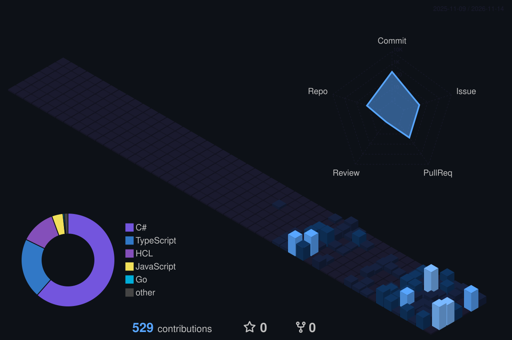

<!-- 🔄 DYNAMIC HEADER: regenerated every 6 hours by profile-update.yml -->

 

   

<!-- 🐍 CONTRIBUTION SNAKE: regenerated every 6 hours by snake.yml -->
<picture>
  <source
    media="(prefers-color-scheme: dark)"
    srcset="https://raw.githubusercontent.com/moamenelbarky/moamenelbarky/output/snake-dark.svg"
  />
  <source
    media="(prefers-color-scheme: light)"
    srcset="https://raw.githubusercontent.com/moamenelbarky/moamenelbarky/output/snake-light.svg"
  />
  
</picture>

## 🚀 About Me

- 💼 **Full-Stack Software Engineer**: .NET, Angular, PostgreSQL, MongoDB,
  Docker, Azure and AWS. I have deployed two full-stack projects to production.
- 🎓 **B.Sc. in Artificial Intelligence** at Menofia University (2024 – expected
  2028).
- ☁️ **AWS Certified Solutions Architect – Associate** (SAA-C03, 798/1000).
- 🌍 **Open-source contributor** to DSpace, GrandNode, angular-editor and Remote
  by FutrX.
- 🌱 Preparing for **Google Summer of Code**. Find me on
  [GitLab](https://gitlab.com/moamenelbarky) too.
- 📚 Reading _Designing Data-Intensive Applications_, _Learning Domain-Driven
  Design_, _Building Microservices_ and _System Design Interview_.

## 🛠️ Featured Projects

<table>
  <tr>
    <td width="50%" valign="top">
      <h3>🧠 QuizNova</h3>
      

        Quiz management platform built with .NET and Angular using Clean
        Architecture, CQRS and rich domain modeling.
      

      <ul>
        <li>
          Transactional outbox with PostgreSQL <code>LISTEN/NOTIFY</code>:
          idle DB queries went from <b>172,800/day to 1 per message</b>.
        </li>
        <li>
          Migrated to MongoDB document modeling: quiz creation is
          <b>4.4× faster</b> (35 ms → 8 ms).
        </li>
        <li>Polymorphic grading for MCQ, True/False and essay questions.</li>
        <li>
          Passwordless CI/CD to Azure via OIDC, Doppler secrets, plus
          Checkov, CodeQL and Trivy scanning.
        </li>
      </ul>
      

        <a href="https://quiznova.dev">🌐 Live</a> ·
        <a href="https://github.com/quiz-nova/quiznova-api">API</a> ·
        <a href="https://github.com/quiz-nova/quiznova-web">Web</a> ·
        <a href="https://github.com/quiz-nova/quiznova-infra">Infra</a>
      

      
    </td>
    <td width="50%" valign="top">
      <h3>🔧 MechanicShop</h3>
      

        Mechanics shop management platform (.NET and Angular) that handles
        customers, employees, work orders and repair tasks.
      

      <ul>
        <li>Clean Architecture and CQRS to orchestrate shop workflows.</li>
        <li>RBAC and JWT authentication.</li>
        <li>Result Pattern instead of exception-based control flow.</li>
        <li>
          Two containers (API and Angular SSR) on Azure Container Apps via
          Terraform, with <b>scale-to-zero</b>.
        </li>
        <li>Observability with Serilog, Loki, Grafana and Sentry.</li>
      </ul>
      

        <a href="https://github.com/mechanicshop/mechanicshop-api">API</a> ·
        <a href="https://github.com/mechanicshop/mechanicshop-web">Web</a>
      

      
    </td>
  </tr>
</table>

## 🌍 Open Source Contributions

<!-- Auto-generated by scripts/update-oss-contrib.mjs. Do not edit by hand. -->
<!-- prettier-ignore-start -->
<!-- OSS-CONTRIB:START -->
| Project | Contribution | Status |
| --- | --- | --- |
| [grandnode/grandnode2](https://github.com/grandnode/grandnode2) ⭐ 1.3K | [Add standard OCI container metadata labels to Dockerfile and CI workflows](https://github.com/grandnode/grandnode2/pull/956) | ✅ Merged Oct 2026 |
| [futrx-com/remote.futrx](https://github.com/futrx-com/remote.futrx) ⭐ 743 | [feat(ci): add automated test coverage workflow and regression enforcement](https://github.com/futrx-com/remote.futrx/pull/297) | ✅ Merged Sep 2026 |
| [DSpace/RestContract](https://github.com/DSpace/RestContract) ⭐ 58 | [Document email template and system config variable endpoints](https://github.com/DSpace/RestContract/pull/381) | 🟡 In review since Sep 2026 |
| [DSpace/dspace-angular](https://github.com/DSpace/dspace-angular) ⭐ 178 | [fix(accessibility): group search filters into single section landmark and remove individual facet landmarks (#5497)](https://github.com/DSpace/dspace-angular/pull/6172) | 🟡 In review since Sep 2026 |
| [kolkov/angular-editor](https://github.com/kolkov/angular-editor) ⭐ 721 | [fix(toolbar): use *ngIf instead of hidden binding to prevent renderin…](https://github.com/kolkov/angular-editor/pull/600) | ✅ Merged Jul 2026 |
| [valtuutus/valtuutus](https://github.com/valtuutus/valtuutus) ⭐ 35 | [fix: bump OpenTelemetry.Exporter.OpenTelemetryProtocol to 1.15.3](https://github.com/valtuutus/valtuutus/pull/211) | ✅ Merged Jul 2026 |
<!-- OSS-CONTRIB:END -->
<!-- prettier-ignore-end -->

## 🧰 Tech Stack

   

  

           

## 📊 Achievements & Metrics

 

  

  

<!-- Regenerated every 6 hours by metrics.yml (needs METRICS_TOKEN) -->

## 🏙️ 3D Contributions

<!-- Regenerated daily by 3d-contrib.yml -->

 

## 🧩 Problem Solving

 

## ✍️ Latest Articles

<!-- Auto-updated every 6 hours by blog-posts.yml from Medium RSS -->
<!-- markdownlint-disable MD013 -->
<!-- BLOG-POST-LIST:START -->
<!-- BLOG-POST-LIST:END -->
<!-- markdownlint-enable MD013 -->

_Follow me on [Medium](https://medium.com/@moamenelbarky) for upcoming
articles._

## 🤝 Connect With Me

  

