<!-- 🔄 DYNAMIC HEADER: regenerated every 6 hours by profile-update.yml -->

 

<!-- 🐍 CONTRIBUTION SNAKE: regenerated every 6 hours by snake.yml -->
<picture>
  <source
    media="(prefers-color-scheme: dark)"
    srcset="https://raw.githubusercontent.com/moamenelbarky/moamenelbarky/output/snake-dark.svg"
  />
  <source
    media="(prefers-color-scheme: light)"
    srcset="https://raw.githubusercontent.com/moamenelbarky/moamenelbarky/output/snake-light.svg"
  />
  
</picture>

## 🚀 About Me

- 💼 **Full-Stack & Cloud Software Engineer**
- 🎓 **B.Sc. in Artificial Intelligence** at Menofia University (2024 –
  expected 2028).
- 🔓 **Open-source contributor** to GitLab, DSpace and more.
- 🦊 Also active on [GitLab](https://gitlab.com/moamenelbarky).

## 🧰 Tech Stack

 

  

## 🏅 Certifications

<!-- Synced from Credly every 6 hours by scripts/update-credly.mjs -->
<!-- CREDLY:START -->

<!-- CREDLY:END -->

## 🔓 Open Source

<!-- Official GitLab Contributor Platform card: level and points -->

 

<!-- Live count of merged PRs to repositories I don't own -->

## 🧩 Problem Solving

  

  

## 🤝 Connect With Me

